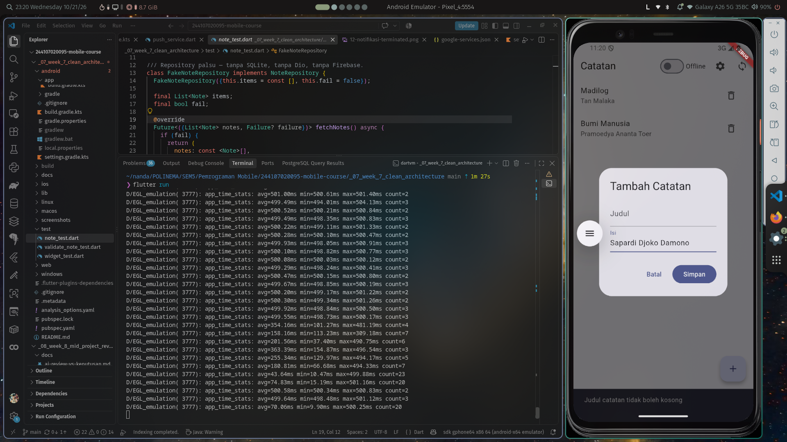
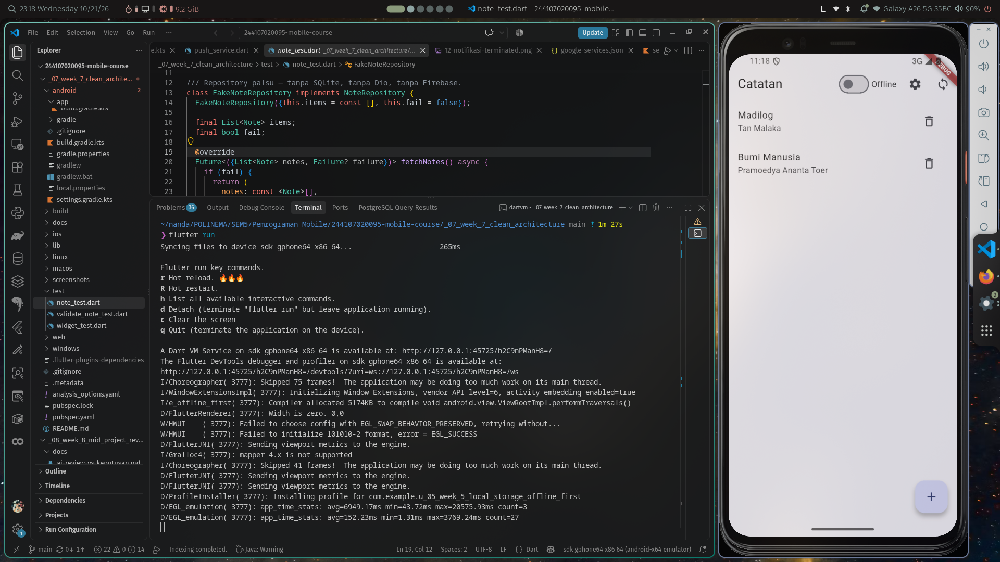
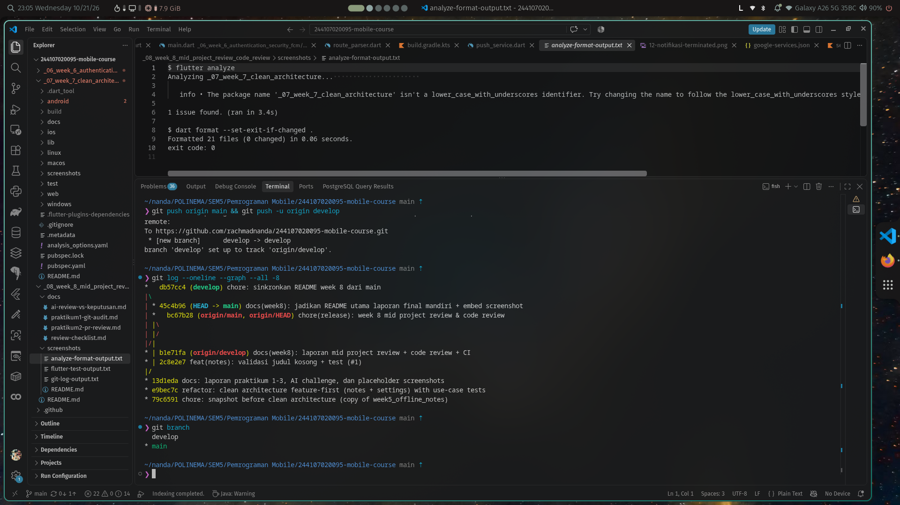

# Week 8 — Mid Project Review & Code Review

Melanjutkan repository portfolio (project **Week 7 Clean Architecture** —
offline notes di `../_07_week_7_clean_architecture/`), **bukan project baru**.
Minggu ini membuktikan disiplin kolaborasi: Git Flow, commit konvensional,
PR kecil, code review terstruktur, mesin hijau, dan verifikasi saran AI.

## Status paruh semester

**SIAP dilanjutkan ke paruh kedua.** Aplikasi berjalan identik dengan akhir
Minggu 7, tiga pemeriksaan mesin hijau, satu PR kecil sudah di-merge via
review, dan fondasi Clean Architecture terbukti lewat tiga grep sterilitas
(NOL semua). Yang dinilai bukan banyaknya fitur, melainkan fondasi yang bisa
dipercaya.

## Peta issue/PR

| Item | Status | Keterangan |
| --- | --- | --- |
| Issue #1 — catatan tanpa judul tersimpan tanpa umpan balik | ✅ Tertutup | Ditutup otomatis oleh PR #1 (`Closes #1`) |
| PR #1 — `feat(notes): validasi judul kosong + test` | ✅ Merged (squash) | `feat/notes-validation` → `develop`, 179 baris, review: request changes → perbaikan → approve |
| Issue #2 — konsistenkan kontrak error notifier | 📋 Terbuka | Lanjutan dari review AI (F1), sengaja tidak dicampur ke PR #1 agar tetap kecil |

> Alur issue/PR disimulasikan lokal dan terdokumentasi penuh karena saat
> pengerjaan repository belum memiliki akses push/GitHub CLI. Disiplin
> alurnya sama: issue → branch `feature/*` dari `develop` → commit
> konvensional → PR → review checklist → squash merge → branch dihapus.

## Peta branch

```text
main      -> rilis stabil, tidak disentuh langsung (hanya via release merge)
develop   -> integrasi mingguan; PR #1 masuk di sini
feature/* -> kerja harian satu fitur (contoh: feat/notes-validation)
```

Histori release Week 8:

```text
*   bc67b28 chore(release): week 8 mid project review & code review  (main)
|\
| * b1e71fa docs(week8): laporan mid project review + code review + CI
| * 2c8e2e7 feat(notes): validasi judul kosong + test (#1)   <- squash merge PR
|/
* 13d1eda docs: laporan praktikum 1-3, AI challenge, dan placeholder screenshots
```

## Fitur utama (hasil Week 8)

1. **Validasi judul catatan** — judul kosong/hanya spasi ditolak di use case
   `AddNote` dengan `ValidationFailure` berpesan ramah pengguna; normalisasi
   (trim) judul & body dipusatkan di domain, UI mengirim nilai mentah.
2. **Disiplin Git Flow** — `develop` dibuat, fitur dikerjakan di
   `feat/notes-validation`, commit konvensional, squash merge, branch dihapus.
3. **CI penjaga kualitas** — `.github/workflows/ci.yml` menolak PR kotor:
   `flutter analyze` + `dart format --set-exit-if-changed` + `flutter test`.

## Stack teknologi

| Komponen | Paket/Alat |
| --- | --- |
| State management / DI | `flutter_riverpod` |
| Navigasi | `go_router` |
| Database lokal | `sqflite` |
| Preferensi | `shared_preferences` |
| Kualitas kode | `flutter analyze`, `dart format`, GitHub Actions |

## Cara menjalankan

```bash
cd _07_week_7_clean_architecture
flutter pub get
flutter analyze
flutter test        # 13 test
flutter run
```

## Bukti mesin hijau

| Perintah | Hasil |
| --- | --- |
| `flutter analyze` | 0 error, 0 warning (sisa 1 info `package_names` bawaan penamaan folder repo, terdokumentasi sejak Week 7) |
| `dart format --set-exit-if-changed .` | exit 0 — tidak ada yang perlu diformat |
| `flutter test` | **13/13 lulus** (8 lama + 5 baru dari PR #1) |
| 3 grep sterilitas | **NOL** semua (presentation steril, domain steril, tanpa DI bocor) |

Output terminal nyata: [`screenshots/analyze-format-output.txt`](screenshots/analyze-format-output.txt),
[`screenshots/flutter-test-output.txt`](screenshots/flutter-test-output.txt),
[`screenshots/git-log-output.txt`](screenshots/git-log-output.txt).

## Bukti visual (screenshot)

| Screenshot | Yang ditunjukkan | Membuktikan |
| --- | --- | --- |
|  | Dialog tambah catatan + SnackBar "Judul catatan tidak boleh kosong" | PR #1: validasi judul kosong bekerja di UI |
|  | Daftar catatan seperti akhir Week 7 | Aplikasi berjalan identik pasca-review |
|  | `git branch` + `git log --graph` menampilkan `main` + `develop` | Git Flow diterapkan |

---

## Laporan Praktikum 1 — Git Flow & commit berkualitas

### Audit riwayat (dijalankan di root repo)

```text
$ git log --oneline -15
13d1eda docs: laporan praktikum 1-3, AI challenge, dan placeholder screenshots
e9bec7c refactor: clean architecture feature-first (notes + settings) with use-case tests
79c6591 chore: snapshot before clean architecture (copy of week5_offline_notes)
f42593b tugas & laporan akhir
1fe4188 ai-challenge
a30c9de praktikum 3
b88ba11 praktikum 1 & 2
c5885a7 fix laporan akhir readme
...

$ git branch -a
* main
  remotes/origin/main

$ git status
nothing to commit, working tree clean
```

**Temuan masalah:**

| # | Masalah | Bukti |
|---|---------|-------|
| 1 | Semua commit langsung ke `main` — tidak ada `develop`/`feature/*` | `git branch -a` hanya `main` |
| 2 | Pesan commit non-konvensional | `tugas & laporan akhir`, `ai-challenge`, `praktikum 1 & 2`, `fix laporan akhir readme` |
| 3 | Satu commit menggabung banyak perubahan logis | `e9bec7c` memuat refactor seluruh struktur + test sekaligus |
| 4 | File tak terlacak | **NOL** — working tree bersih |

**Tindak lanjut:** `develop` dibuat dari `main` (sekali), fitur dikerjakan di
`feat/notes-validation` dengan 3 commit konvensional:

```text
b7fc97a fix(notes): normalisasi body di use case + test failure repository
0b3a3b9 feat(notes): validasi judul kosong + test
7b51802 style: rapikan dart format pada project week 7
```

### Perbaikan pesan commit buruk (tabel before/after)

| Sebelum (pesan lama) | Sesudah (format konvensional) | Alasan |
| --- | --- | --- |
| `tugas & laporan akhir` | `docs(week6): laporan tugas auth/FCM + refleksi akhir` | Tipe `docs` jelas (bukan kode), scope menunjukkan lokasi, deskripsi menyebut apa yang ditulis — bisa di-revert tanpa menebak isi commit. |
| `fix laporan akhir readme` | `docs(week6): perbaiki tautan screenshot di README laporan` | "fix" tanpa scope memaksa reviewer membuka diff; versi baru menjawab *apa* (tautan), *di mana* (README week 6), *jenisnya* (docs). |
| `praktikum 1 & 2` | `feat(week6): praktikum 1-2 — integrasi Firebase Auth + FCM token` | Pesan lama hanya menyalin nomor tugas; versi baru menyebut fitur sehingga `git log` bisa dibaca sebagai changelog. |

---

## Laporan Praktikum 2 — Pull Request & code review

### Issue

```text
Issue #1 — Catatan tanpa judul bisa "disimpan" tanpa umpan balik

Langkah reproduksi:
1. Jalankan aplikasi (_07_week_7_clean_architecture).
2. Tekan FAB (+), kosongkan field Judul, tekan Simpan.
3. Tidak terjadi apa-apa: dialog tetap terbuka, tidak ada pesan error.

Penyebab: notes_page.dart memiliki `if (title.isEmpty) return;` — diam-diam
keluar tanpa feedback, dan use case AddNote tidak punya validasi sama sekali.

Ekspektasi: judul kosong ditolak dengan pesan error yang jelas.
```

### Pull Request (template lengkap)

```text
Judul: feat(notes): validasi judul kosong + test

Masalah: pengguna bisa menekan Simpan dengan judul kosong dan tidak
mendapat umpan balik apa pun (dialog tetap terbuka, tidak ada error).

Solusi:
- Validasi di use case AddNote: judul kosong/hanya spasi -> ValidationFailure
  dengan pesan ramah pengguna (aturan bisnis tinggal di domain, bukan UI).
- Normalisasi (trim) judul & body dipusatkan di use case.
- UI mengirim nilai mentah controller; failure ditampilkan sebagai SnackBar.

Cara uji:
1. Tambah catatan dengan judul kosong -> SnackBar "Judul catatan tidak
   boleh kosong" muncul, catatan tidak tersimpan.
2. flutter test test/validate_note_test.dart -> 5 test hijau.
3. flutter analyze -> bersih; dart format --set-exit-if-changed . -> exit 0.

Ukuran: 179 baris perubahan, 3 commit konvensional (< 300 baris, < 3 hari).

Closes #1
```

### Hasil review (checklist codelab)

Keputusan awal: **Request changes** — 2 item wajib, 3 item saran. Komentar
memakai pola observasi → dampak → usulan konkret.

**Temuan kebenaran (2):**

1. **(wajib)** Observasi: `title` di-trim di use case, tetapi `body` masih
   di-trim di `notes_page.dart`. Dampak: aturan yang sama tersebar di dua
   layer; pemanggil `AddNote` lain tidak mendapat normalisasi body. Usulan:
   pindahkan `body.trim()` ke use case; UI kirim nilai mentah.
2. **(saran)** Observasi: saat validasi gagal, SnackBar dirender pada Scaffold
   di balik route dialog. Dampak: berisiko kurang terlihat. Usulan: idealnya
   `errorText` pada field Judul.

**Temuan arsitektur (1):**

3. **(wajib)** Observasi: widget masih menjalankan `.trim()` — normalisasi
   input adalah aturan bisnis. Dampak: presentation tidak lagi "hanya
   ref.watch + render". Usulan: hapus semua `.trim()` dari halaman, pusatkan
   di `AddNote`.

**Temuan test (1):**

4. **(wajib)** Observasi: test baru tidak meng-cover jalur repository
   mengembalikan failure. Dampak: regresi jalur error tidak terdeteksi.
   Usulan: tambah spy dengan flag `fail`, assert failure diteruskan.

**Temuan keterbacaan (1):**

5. **(saran)** Observasi: `FakeNoteRepository` dan `SpyNoteRepository`
   mengimplementasikan kontrak yang sama di dua file test. Usulan: ekstrak ke
   `test/helpers/` saat fake ketiga muncul.

### Tindak lanjut dan merge

| Item | Status | Bukti |
| --- | --- | --- |
| K1/A1: trim dipusatkan di use case | ✅ Diperbaiki | commit `b7fc97a`; `notes_page.dart` bebas `.trim()` |
| T1: test failure repository | ✅ Diperbaiki | commit `b7fc97a`; test "failure dari repository diteruskan tanpa dilempar" hijau |
| K2: errorText di dialog | ⏸️ Ditunda beralasan | SnackBar terverifikasi terlihat di atas barrier dialog; `errorText` butuh `StatefulBuilder` — di luar cakupan PR kecil |
| R1: ekstrak fake bersama | ⏸️ Ditunda beralasan | Menjaga PR < 300 baris; diekstrak saat fake ketiga muncul |

**Re-review:** approve — semua item wajib selesai, analyze bersih, test
13/13 hijau. **Merge:** squash ke `develop` (commit perantara digabung agar
histori bersih), issue #1 tertutup via `Closes #1`, branch
`feat/notes-validation` dihapus.

---

## Laporan Praktikum 3 — Static analysis & CI

### Tiga perintah mesin (setelah PR #1 masuk `develop`)

```text
$ flutter analyze
Analyzing _07_week_7_clean_architecture...
1 issue found. (info package_names di pubspec.yaml — bawaan penamaan folder repo)

$ dart format --set-exit-if-changed .
Formatted 21 files (0 changed) in 0.05 seconds.   <- exit 0

$ flutter test
00:00 +13: All tests passed!
```

Urutan perbaikan: error → warning → info. Satu info nyata
(`curly_braces_in_flow_control_structures` di `test/note_test.dart`)
diperbaiki dalam PR #1; info `package_names` sengaja dibiarkan karena nama
folder repo kampus berawalan digit (terdokumentasi sejak Week 7).

### CI penolak otomatis

`.github/workflows/ci.yml` di root repo:

```yaml
name: ci

on: [pull_request]

jobs:
  verify:
    runs-on: ubuntu-latest
    defaults:
      run:
        working-directory: _07_week_7_clean_architecture
    steps:
      - uses: actions/checkout@v4
      - uses: subosito/flutter-action@v2
      - run: flutter pub get
      - run: flutter analyze
      - run: dart format --set-exit-if-changed .
      - run: flutter test
```

PR kotor ditolak mesin sebelum dibaca manusia.

### Kesiapan paruh semester

| Kriteria | Status | Bukti |
| --- | --- | --- |
| Struktur feature-first terbukti (3 grep sterilitas) | ✅ | Ketiga grep **NOL** (di bawah) |
| `flutter analyze` bersih | ✅ | 0 error / 0 warning |
| `flutter test` hijau | ✅ | 13/13 lulus |
| PR kecil + commit jelas | ✅ | PR #1: 179 baris, 3 commit konvensional, squash merge |
| README + screenshot + cara menjalankan | ✅ | File ini + `screenshots/` |
| Semua komentar review ditindaklanjuti | ✅ | 2 request-changes diperbaiki, re-review approve |

Tiga grep sterilitas (dijalankan ulang pada `develop` pasca-merge):

```text
=== GREP 1: presentation steril dari data mentah ===
NOL
=== GREP 2: domain steril dari framework/package ===
NOL
=== GREP 3: widget tidak instansiasi repository ===
NOL
```

---

## AI Challenge

AI menjadi reviewer awal; keputusan final tetap milik author. Dokumen ini
menyimpan prompt, output mentah, verifikasi, dan keputusan.

### Prompt yang diberikan

```text
Review PR Flutter ini sebagai senior Flutter dev.
Konteks: feature-first Clean Architecture (presentation -> domain <- data),
Riverpod, GoRouter, SQLite + Dio.
Fokus: kebenaran, arsitektur, dan test. Abaikan style.
Berikan 5 temuan teratas + level (blocker/saran)
+ alasan + usulan potongan kode perbaikan.

[diff PR #1: feat(notes) validasi judul kosong + test, 179 baris]
```

### Output awal AI (mentah)

> **F1 — (saran, kebenaran):** `NotesNotifier.build()` dan `sync()` melempar
> `Exception(result.failure!.message)`, sementara `addNote`/`deleteNote`
> mengembalikan `Failure?`. Kontrak error tidak konsisten; UI membersihkan
> string dengan `replaceFirst('Exception: ', '')` yang rapuh.
> Usul: seragamkan kontrak error notifier.
>
> **F2 — (saran, test):** `SpyNoteRepository` menduplikasi
> `FakeNoteRepository` untuk kontrak yang sama.
> Usul: ekstrak fake bersama di `test/helpers/`.
>
> **F3 — (blocker, kebenaran):** `titleController`/`bodyController`
> berpotensi bocor memori jika dialog ditutup via barrier dismiss.
> Usul: `try/finally` atau `StatefulBuilder`.
>
> **F4 — (saran, style):** Tambahkan `const` pada `SnackBar`, pertimbangkan
> `FilledButton.tonal` untuk aksi batal.
>
> **F5 — (saran, arsitektur):** `ValidationFailure` di `core/` padahal hanya
> dipakai fitur notes; pindahkan ke `features/notes/domain/`.

### Verifikasi tiap temuan

| # | Klaim AI | Verifikasi | Terbukti? |
| --- | --- | --- | --- |
| F1 | Notifier melempar `Exception`, UI parsing string | `grep -n "throw Exception" notes_providers.dart` → baris 48, 75, 85; `grep -n "replaceFirst" notes_page.dart` → baris 87 | **BENAR** |
| F2 | Dua fake repository untuk kontrak sama | `grep -l "implements NoteRepository" test/*.dart` → `note_test.dart` + `validate_note_test.dart` | **BENAR** |
| F3 | Controller bocor saat barrier dismiss | Baca `notes_page.dart`: `await showDialog(...)` (baris 17) selalu dilanjutkan ke `dispose()` (baris 64-65) apapun cara dialog ditutup. Reproduksi manual: dismiss via barrier, tidak ada leak | **SALAH** |
| F4 | const & varian tombol | Nitpick style murni; ranah formatter/linter (prompt pun sudah bilang "abaikan style") | **DITOLAK** |
| F5 | Pindah `ValidationFailure` ke domain notes | `core/failures.dart` layer paling dalam, dipakai domain **dan** data; memindah satu subtipe memecah `sealed class Failure` | **DITOLAK** |

### Tabel usulan AI vs keputusan final

| Usulan AI | Keputusan final | Alasan teknis |
| --- | --- | --- |
| F1: konsistenkan kontrak error notifier | **Diterima sebagai issue lanjutan (#2)** | Terbukti benar, tetapi refactor kontrak error menyentuh `build`/`sync`/`noteByIdProvider` + UI — di luar cakupan PR validasi 179 baris |
| F2: ekstrak fake bersama | **Diterima, ditunda** | Terbukti benar; dieksekusi saat fake ketiga muncul agar PR tetap < 300 baris |
| F3: memory leak controller | **Ditolak** | Tuduhan tidak terbukti: `dispose()` selalu berjalan setelah `await showDialog` selesai, termasuk barrier dismiss |
| F4: const & varian tombol | **Ditolak** | Nitpick style; sudah ditangani formatter/linter/CI |
| F5: pindah `ValidationFailure` | **Ditolak** | `core/` adalah layer dalam yang sah; memindah subtipe memecah `sealed class` dan menduplikasi pola antar-fitur |

**Ringkasan:** 2 temuan AI terbukti benar dengan bukti grep, 3 ditolak dengan
alasan tertulis. Keputusan final berbeda dari output mentah AI pada 3 dari 5
temuan — review AI diverifikasi dulu, tidak diterima mentah.

---

## Refleksi

**1. Apa beda LGTM buta dengan approve yang bertanggung jawab? Apa risikonya bagi tim?**

LGTM buta = approve tanpa menarik branch, menjalankan test, atau membaca diff
dengan checklist. Approve bertanggung jawab berarti reviewer ikut memiliki
konsekuensi kode: ia checkout, menjalankan mesin, dan menguji manual. Risiko
LGTM buta bagi tim: bug lolos ke `develop`, kepercayaan antar-anggota turun,
dan review kehilangan fungsi sebagai gerbang kualitas — tinggal menunggu
insiden produksi untuk membuktikannya.

**2. Kapan komentar wajib berstatus request changes, dan kapan cukup saran?**

Request changes bila temuan menyangkut **kebenaran atau kontrak** (bug, jalur
error tak ter-cover, aturan bisnis bocor layer) — kode tidak boleh masuk
sebelum diperbaiki. Cukup saran bila soal preferensi, keterbacaan minor, atau
perbaikan yang lebih mahal dari manfaatnya pada PR kecil — dicatat dan
diputuskan author dengan alasan.

**3. Bagian mana dari review AI yang Anda tolak atau sederhanakan, dan mengapa?**

Tuduhan memory leak yang tidak terbukti (dibantah dengan membaca alur
`await showDialog` → `dispose()`), nitpick style (sudah ranah CI), dan
pemindahan `ValidationFailure` yang memecah `sealed class`. Dua temuan benar
juga **disederhanakan cakupannya**: diterima sebagai issue lanjutan, bukan
dicampur ke PR 179 baris — menjaga PR tetap reviewable lebih penting daripada
"sekalian membereskan semuanya".

**4. Satu hal konkret yang Anda perbaiki setelah review sejawat — apa dampaknya?**

Memindahkan `.trim()` body dari `notes_page.dart` ke use case `AddNote`.
Dampaknya: presentation kembali steril dari aturan bisnis, semua pemanggil
`AddNote` di masa depan otomatis mendapat normalisasi yang sama, dan ada test
("body ikut dinormalisasi di use case") yang mengunci perilaku itu.

---

## Dokumen pendukung (versi detail)

| File | Isi |
| --- | --- |
| [`docs/praktikum1-git-audit.md`](docs/praktikum1-git-audit.md) | Audit git lengkap + output perintah |
| [`docs/praktikum2-pr-review.md`](docs/praktikum2-pr-review.md) | Issue #1, PR #1, review, tindak lanjut |
| [`docs/review-checklist.md`](docs/review-checklist.md) | Perbaikan commit, mesin, CI, kesiapan mid |
| [`docs/ai-review-vs-keputusan.md`](docs/ai-review-vs-keputusan.md) | Prompt, output AI, verifikasi, keputusan |
| [`screenshots/README.md`](screenshots/README.md) | Daftar bukti terminal + placeholder UI |
