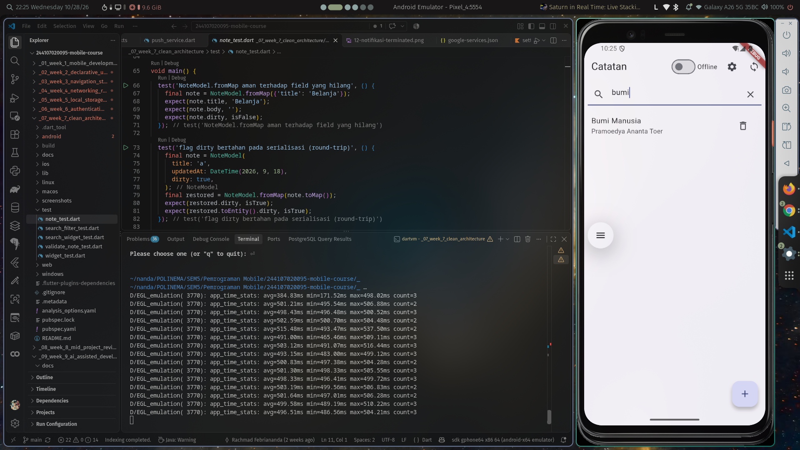
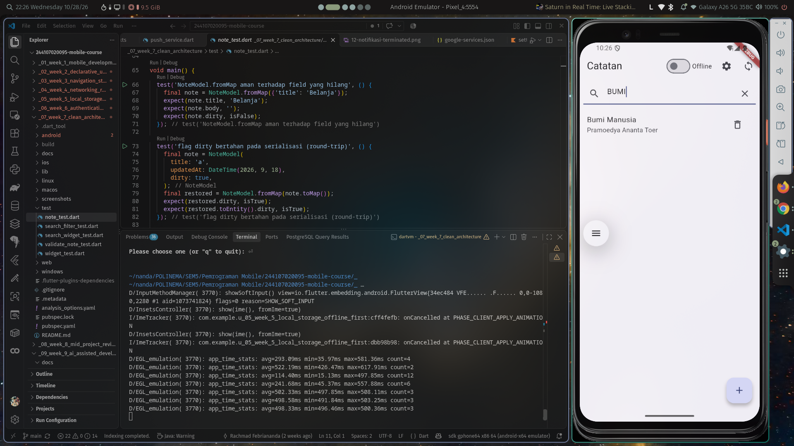
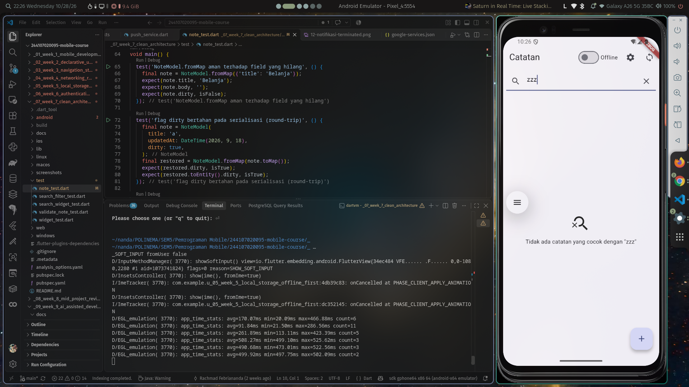
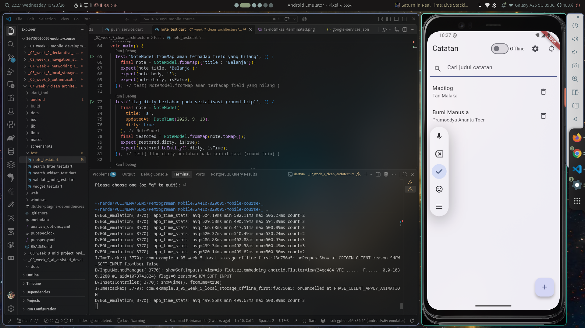

# Week 9 — AI-Assisted Development / Vibe Coding

Melanjutkan repository portfolio (project **Week 7–8 Clean Architecture** —
offline notes di `../_07_week_7_clean_architecture/`), **bukan project baru**.
Minggu ini menambah **satu fitur kecil dengan bantuan AI**: pencarian judul
catatan + empty state — lalu diverifikasi, diuji, dan di-refactor sampai
benar-benar layak masuk `develop`.

Nilai ada pada **kualitas verifikasi**, bukan banyaknya kode AI. Dua
halusinasi AI berhasil dibuktikan dengan `flutter analyze` dan test merah,
lalu diperbaiki.

## Fitur: pencarian judul catatan

- Kolom pencarian di atas daftar catatan.
- Pencocokan **case-insensitive** pada judul, spasi di tepi query diabaikan.
- Query kosong = semua catatan (tanpa filter).
- **Empty state** membedakan dua kondisi: "Belum ada catatan" (data kosong)
  vs `Tidak ada catatan yang cocok dengan "<query>"` (tidak ada hasil).
- Tombol **clear** mengosongkan field **dan** state query.

## Siklus yang dijalankan

| Langkah | Yang dilakukan | Bukti |
| --- | --- | --- |
| 1. Prompt | Prompt 5 slot + konteks struktur folder & kontrak repository | [`docs/ai-log.md`](docs/ai-log.md) §1 |
| 2. Generate | DRAFT v1 AI ditempel apa adanya | §2 |
| 3. Verify | `grep` import terlarang + `flutter analyze` + cek API ke source package | §2, §5 |
| 4. Test | Test merah pembukti bug → diperbaiki → hijau | §3, §6 |
| 5. Refactor | Filter pindah ke use case domain, state ke provider | §4 |
| 6. Explain | Refleksi tanpa membuka AI | bawah |

## Halusinasi AI yang ditemukan (bukti nyata)

**1. Method fiktif — `String.containsIgnoreCase()`**

```text
error • The method 'containsIgnoreCase' isn't defined for the type 'String'
        • notes_page.dart:13:43 • undefined_method
```

Tidak ada di Dart SDK (yang ada `contains`, `toLowerCase`). Dibuktikan dengan
`flutter analyze` + autocomplete IDE.

**2. Package kadaluarsa — `AsyncValue.valueOrNull` (API Riverpod 2)**

```text
error • The getter 'valueOrNull' isn't defined for the type 'AsyncValue<List<Note>>'
```

Diverifikasi langsung ke package terpasang:
`grep -rn "get value" ~/.pub-cache/hosted/pub.dev/riverpod-3.4.3/lib/src/common/result.dart`
→ `ValueT? get value;` (Riverpod 3 memakai `value`, bukan `valueOrNull`).

**3. Logika yakin tapi salah — filter case-sensitive**

DRAFT v2 lolos `flutter analyze`, tetapi pencarian "BELANJA" hanya menemukan
1 dari 2 catatan. Dibuktikan dengan test merah:

```text
Expected: an object with length of <2>
  Actual: [Instance of 'Note']
```

## Refactor ke Clean Architecture

| Sebelum (output AI) | Sesudah |
| --- | --- |
| `filterNotes()` di `presentation/pages/notes_page.dart` | `domain/usecases/search_notes.dart` (fungsi murni) |
| `setState(() => _query = ...)` di widget | `searchQueryProvider` + `filteredNotesProvider` |
| `import 'package:sqflite/sqflite.dart'` di presentation | dihapus (dependency rule) |
| Case-sensitive, tanpa trim | `toLowerCase()` + `trim()` di use case |

```dart
class SearchNotes {
  const SearchNotes();

  List<Note> call(List<Note> notes, String query) {
    final keyword = query.trim().toLowerCase();
    if (keyword.isEmpty) return notes;
    return notes
        .where((note) => note.title.toLowerCase().contains(keyword))
        .toList();
  }
}
```

## Struktur file yang berubah

```text
lib/features/notes/
├── domain/usecases/search_notes.dart          # BARU — aturan filter murni
└── presentation/
    ├── providers/notes_providers.dart         # + searchQueryProvider, filteredNotesProvider, searchNotesProvider
    └── pages/notes_page.dart                  # + kolom search, empty state, clear
test/
├── search_filter_test.dart                    # BARU — 6 test use case
└── search_widget_test.dart                    # BARU — 4 widget test (empty state, clear, case-insensitive)
```

## Stack teknologi

| Komponen | Paket/Alat |
| --- | --- |
| State management / DI | `flutter_riverpod` 3.4.3 |
| Navigasi | `go_router` 18 |
| Database lokal | `sqflite` 2.4.4 |
| Preferensi | `shared_preferences` 2.5.5 |
| Kualitas kode | `flutter analyze`, `dart format`, `flutter test` |

## Cara menjalankan

```bash
cd _07_week_7_clean_architecture
flutter pub get
flutter analyze
flutter test        # 23 test
flutter run
```

## Bukti mesin hijau

| Perintah | Hasil |
| --- | --- |
| `flutter analyze` | 0 error, 0 warning (sisa 1 info `package_names` bawaan penamaan folder repo) |
| `dart format --set-exit-if-changed .` | exit 0 |
| `flutter test` | **23/23 lulus** (13 lama + 10 baru) |
| 4 grep sterilitas | **NOL** semua |

```text
=== GREP 1: presentation steril dari data mentah ===        NOL
=== GREP 2: domain steril dari framework/package ===        NOL
=== GREP 3: widget tidak instansiasi repository ===          NOL
=== GREP 4: logika filter tidak tinggal di presentation ===  NOL
```

Output mentah: [`screenshots/`](screenshots/README.md).

## AI Challenge — review kode search

Prompt review (3 temuan + level + alasan) dijalankan pada kode search final.
Detail lengkap: [`docs/ai-log.md`](docs/ai-log.md) §6.

| # | Temuan AI | Level | Keputusan | Alasan |
| --- | --- | --- | --- | --- |
| 1 | Tombol clear tidak mengosongkan `TextField` (tanpa controller) | blocker | **DITERIMA + diperbaiki** | Test merah: `Expected: empty, Actual: 'bumi'` |
| 2 | `SearchNotes` mengembalikan referensi list asli saat query kosong | saran | **DITOLAK** | Semua pemanggil read-only; `Note` immutable; menyalin list tiap rebuild = alokasi tanpa manfaat |
| 3 | Tambah debounce 150 ms pada input pencarian | saran | **DITOLAK** | Filter in-memory `O(n)` tanpa I/O; debounce menambah `Timer` + test flaky = over-engineering |

**Keputusan per file:**

| File | Keputusan |
| --- | --- |
| `notes_page.dart` (draft AI) | **TOLAK + tulis manual** (import lintas layer, filter di widget) |
| `domain/usecases/search_notes.dart` | **TULIS MANUAL** (AI menaruh logika di presentation) |
| `notes_providers.dart` | **TERIMA + REFACTOR** (ide state query dipindah ke provider) |
| `search_filter_test.dart` | **TULIS MANUAL** (test AI hanya kasus sukses) |
| `search_widget_test.dart` | **TULIS MANUAL** (AI tidak memberi widget test) |
| `TextEditingController` (temuan #1) | **TERIMA** (bug nyata) |

## Screenshot

| Screenshot | Yang ditunjukkan |
| --- | --- |
|  | Query "bumi" → 1 hasil |
|  | Query "BUMI" → hasil sama |
|  | Query "zzz" → empty state |
|  | Setelah clear → semua catatan, field kosong |

## Refleksi

**1. Satu halusinasi AI apa yang Anda temukan dan bagaimana membuktikannya?**

Dua. Pertama, `String.containsIgnoreCase()` — method yang **tidak ada** di
Dart; dibuktikan dengan `flutter analyze` (`undefined_method` di
`notes_page.dart:13`) dan autocomplete IDE. Kedua, `AsyncValue.valueOrNull`
yang merupakan API Riverpod 2; dibuktikan dengan membaca source package yang
benar-benar terpasang (`riverpod-3.4.3/lib/src/common/result.dart` → getter
bernama `value`). Selain itu ada *logika yakin tapi salah*: filter
case-sensitive yang lolos analyze tetapi gagal pada test "BELANJA".

**2. Prompt mana yang paling membantu dan apa yang Anda ubah?**

Prompt 5 slot (peran–konteks–tugas–batas–output). Yang paling berpengaruh
adalah slot **Batas**: "jangan panggil SQLite dari widget" dan "domain bebas
Flutter/SQLite" membuat saya langsung tahu bahwa draft v1 melanggar aturan
saat melihat `import 'package:sqflite'`. Yang saya ubah: menyertakan
**kontrak `NoteRepository` dan definisi entity `Note`** secara eksplisit —
tanpa itu AI mengarang signature sendiri. Sebaliknya saya tidak menyertakan
seluruh repo (500 file) karena justru mengaburkan batas.

**3. Satu refactor apa yang Anda lakukan pada kode AI?**

Memindahkan `filterNotes()` dari `presentation/pages/notes_page.dart` ke
`domain/usecases/search_notes.dart` sebagai fungsi murni, dan mengganti
`setState` lokal dengan `searchQueryProvider` + `filteredNotesProvider`.
Dampak: aturan pencarian bisa diuji tanpa widget (6 test murni), presentation
kembali steril (grep #4 = NOL), dan `flutter analyze` bersih tanpa import
lintas layer.

**4. Keputusan terima/tolak mana yang paling sulit?**

Menolak saran **debounce**. Secara "best practice" debounce terdengar benar
dan sering muncul di artikel pencarian — menolaknya terasa melawan arus.
Yang membuat saya yakin: filter ini in-memory `O(n)` tanpa I/O, jadi debounce
hanya menambah `Timer` yang harus dibatalkan dan test berbasis waktu yang
flaky. Saya catat syarat kapan saran itu jadi relevan (bila query memicu
SQLite `LIKE` atau request jaringan) supaya keputusan ini bisa ditinjau ulang
tanpa debat ulang dari nol.

## Dokumen pendukung

| File | Isi |
| --- | --- |
| [`docs/ai-log.md`](docs/ai-log.md) | Prompt, output AI, verifikasi, tabel keputusan, bukti |
| [`screenshots/README.md`](screenshots/README.md) | Daftar bukti terminal + screenshot UI |
