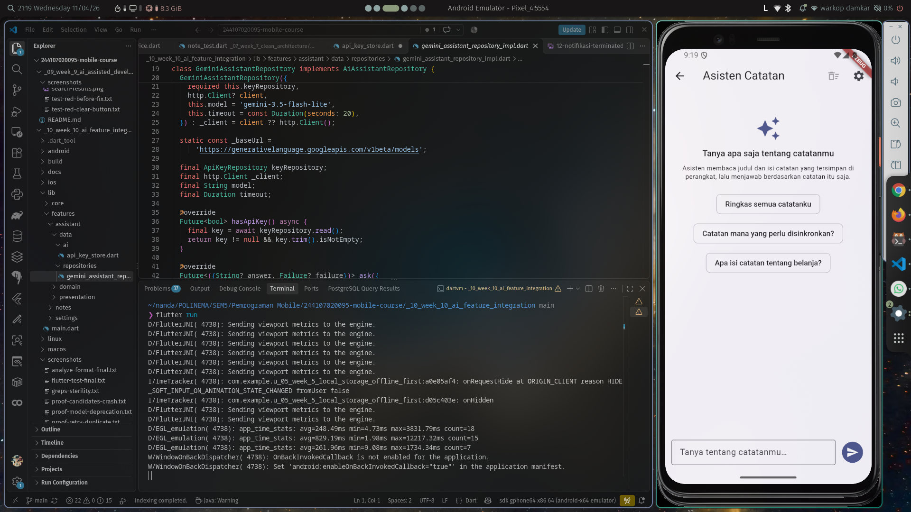
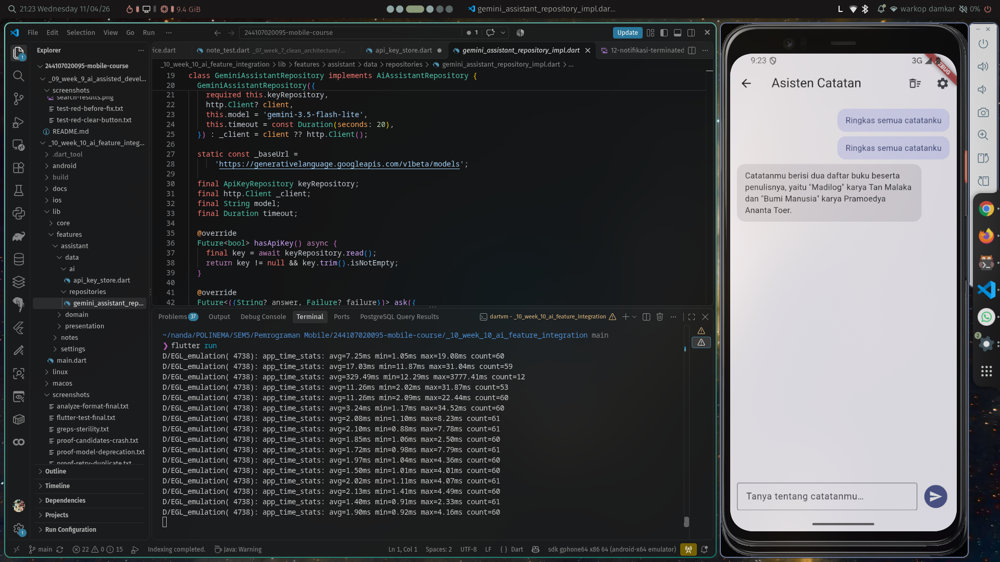
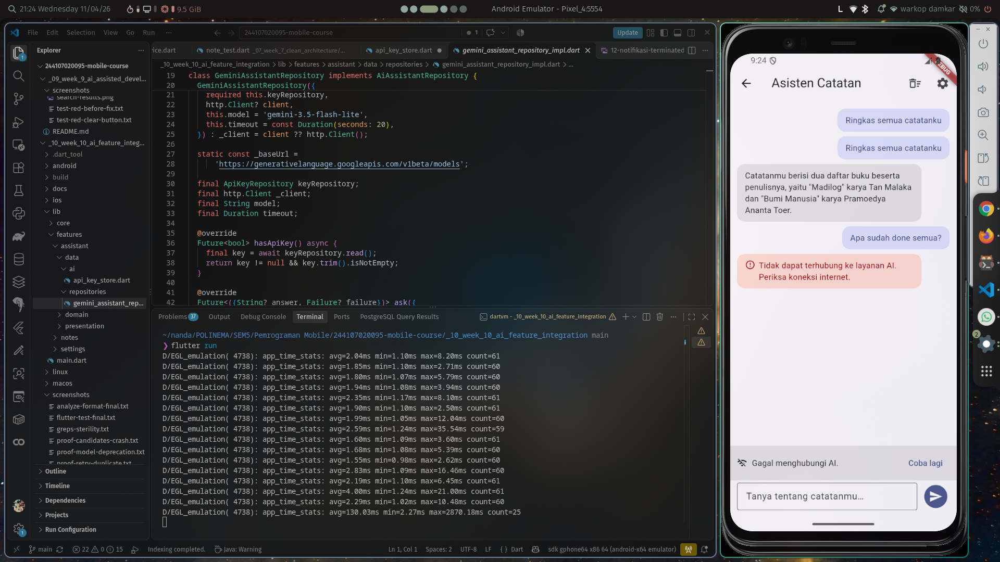
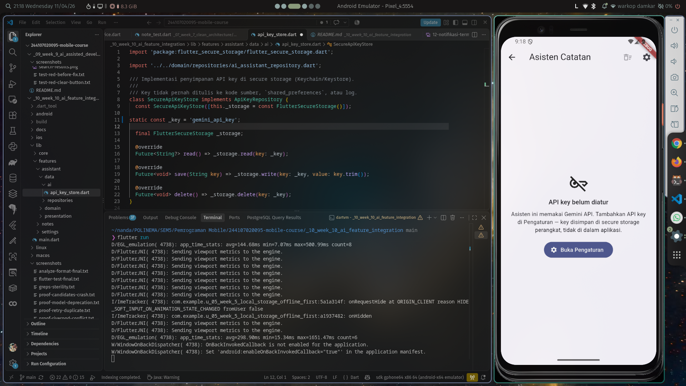
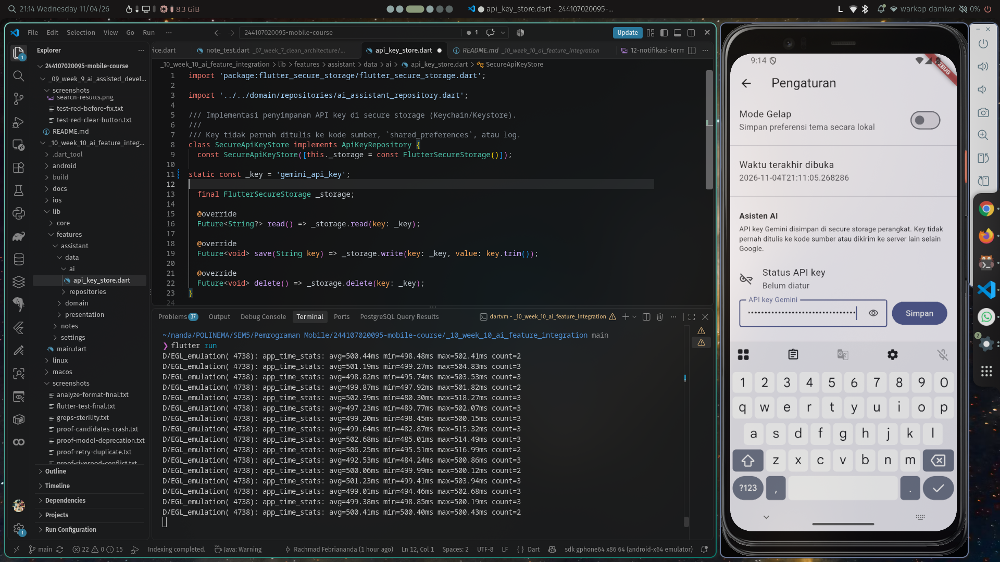

# Week 10 — Integrasi Fitur AI: Chat Asisten Catatan

Melanjutkan repository portfolio (project **Week 7 Clean Architecture** —
aplikasi catatan offline di `../_07_week_7_clean_architecture/`), **bukan
project baru**. Minggu ini menambah **satu fitur AI**: chat asisten yang
menjawab pertanyaan berdasarkan catatan yang tersimpan di perangkat.

Nilai laporan ini ada pada **verifikasi**: kode contoh codelab tidak dipakai
apa adanya. Enam masalah nyata (model pensiun, konflik dependensi, API key di
URL, parsing yang crash, exception mentah, tanpa timeout) dibuktikan dengan
dokumentasi resmi, `flutter analyze`, dan test merah — lalu diperbaiki.

> **Status uji live:** **sudah dijalankan** di emulator Android (Pixel_4)
> pada 4 November 2026 — jalur sukses (jawaban model nyata), fallback tanpa
> API key, dan fallback kegagalan jaringan semuanya terbukti. Bukti:
> [`screenshots/`](screenshots/README.md). Test otomatis: **76/76 lulus**.
> Rincian: [`docs/ai-log.md`](docs/ai-log.md) §7.3 dan §8.

## Fitur: chat asisten catatan

- Tombol **Asisten AI** (ikon ✨) di AppBar halaman catatan → rute `/assistant`.
- Pengguna bertanya; aplikasi mengirim **konteks catatan lokal + pertanyaan**
  ke Gemini, lalu menampilkan jawaban sebagai balon chat.
- **System prompt** membatasi jawaban: Bahasa Indonesia, maksimal 3 kalimat,
  hanya berdasarkan catatan, dan **tidak mengarang** bila datanya tidak ada.
- **Empty state** menampilkan tiga contoh pertanyaan yang bisa langsung
  ditekan (mis. "Ringkas semua catatanku").
- **Indikator "AI sedang menulis…"** selama menunggu, tombol kirim dinonaktifkan.
- **Tanpa API key** halaman menampilkan ajakan ke Pengaturan — API tidak
  dipanggil sama sekali (tidak ada request yang pasti gagal).
- **API key** diatur di halaman Pengaturan: field tersembunyi, tombol
  simpan/hapus, dan indikator status "Tersimpan di perangkat".

## Arsitektur

```text
┌──────────────────────────────────────────────────────────────┐
│ presentation                                                 │
│  assistant_page.dart ──watch──> assistant_providers.dart     │
│  message_bubble.dart            (satu-satunya wiring DI)     │
└───────────────────────────┬──────────────────────────────────┘
                            │ memanggil use case
┌───────────────────────────▼──────────────────────────────────┐
│ domain (murni Dart — tanpa Flutter/http/storage)             │
│  AskAssistant  ──> susun prompt + PrivacyGuard               │
│  AiAssistantRepository (kontrak)   ApiKeyRepository (kontrak)│
│  ChatMessage (entity)                                        │
└───────────────────────────┬──────────────────────────────────┘
                            │ implementasi
┌───────────────────────────▼──────────────────────────────────┐
│ data                                                         │
│  GeminiAssistantRepository ──http──> Gemini REST API         │
│  SecureApiKeyStore ──> flutter_secure_storage                │
└──────────────────────────────────────────────────────────────┘
```

Aturan yang dijaga (dibuktikan grep di §Bukti mesin hijau):

| Aturan | Konsekuensi |
| --- | --- |
| Domain tidak mengimpor Flutter/http/storage | Aturan bisnis bisa diuji tanpa framework |
| Presentation tidak memanggil `http`/`jsonDecode` | Tidak ada detail transport di UI |
| Widget tidak membuat `Repository()` sendiri | Semua lewat provider, mudah di-fake saat test |
| API key tidak pernah ada di kode sumber | Tidak bocor lewat git |

## Alur satu pertanyaan

```text
User mengetik pertanyaan
        │
        ▼
ChatNotifier.send()  ──> tambah bubble user, state = loading
        │
        ▼
AskAssistant.call(question, notes)
        ├─ sanitize(question)         → redaksi email/NIK/telepon
        ├─ ambil maksimal 5 catatan
        ├─ sanitize + trimContext(1500 char) tiap catatan
        └─ susun user prompt
        │
        ▼
GeminiAssistantRepository.ask()
        ├─ baca key dari secure storage (kosong → AiFailure)
        ├─ POST + header x-goog-api-key + timeout 20 s
        └─ parsing defensif → (answer | AiFailure)
        │
        ▼
Sukses  → bubble assistant
Gagal   → bubble error + banner "Coba lagi" (hanya bila retryable)
```

## Prompt design

| Komponen | Isi | Tujuan |
| --- | --- | --- |
| System prompt | "Kamu asisten catatan pribadi yang ramah. Jawab dalam Bahasa Indonesia, maksimal 3 kalimat, hanya berdasarkan catatan yang diberikan. Jika jawabannya tidak ada di catatan, katakan bahwa datanya tidak ada. Jangan mengarang isi catatan dan jangan meminta data pribadi." | Persona + batas panjang + anti-halusinasi |
| User prompt | Daftar catatan (judul: isi) + baris `Pertanyaan: …` | Memberi konteks yang relevan |
| Batas konteks | maks. 5 catatan, 1500 karakter per catatan | Kendali biaya token |
| Batas privasi | email/NIK/telepon → `[email]`/`[nik]`/`[telepon]` | Data pribadi tidak keluar dari perangkat |

Contoh user prompt yang benar-benar disusun:

```text
Catatan pengguna:
- Belanja: susu dan telur
- Kuliah: tugas mobile dikumpulkan Jumat

Pertanyaan: Apa isi catatan belanja?
```

## Tabel risiko dan mitigasi

| Risiko | Dampak | Mitigasi di kode | Bukti |
| --- | --- | --- | --- |
| **Data pribadi bocor** ke AI API | NIK/email/telepon terkirim ke pihak ketiga | `PrivacyGuard.redact()` dijalankan di **use case** (bukan widget), sehingga tidak bisa dilewati pemanggil baru; riwayat chat tidak dikirim ulang | 10 test `privacy_guard_test.dart`; 2 test redaksi di `ask_assistant_test.dart` |
| **API key bocor** | Kuota/akun disalahgunakan | Key disimpan di `flutter_secure_storage`; dikirim lewat header `x-goog-api-key`, **bukan** `?key=`; tidak ada key di kode/log; dijaga test `no_hardcoded_secrets_test.dart` | Grep `AIza…` + `AQ.…` = NOL; test penjaga merah bila key ditempel |
| **Biaya melonjak** | Tagihan tak terduga | Maks. 5 catatan + 1500 karakter per catatan; jawaban diminta ≤3 kalimat; tanpa multi-turn; timeout 20 s | 10 test `ask_assistant_test.dart` |
| **API error / down** | Fitur macet | Semua status HTTP dipetakan ke pesan ramah; 5xx/timeout/`ClientException` → `retryable` + tombol "Coba lagi"; tidak ada exception mentah ke widget | 17 test `gemini_repository_test.dart` |
| **Prompt diblokir safety** | Respons tanpa `candidates` | Parsing defensif: cek `promptFeedback.blockReason`, panjang `candidates`/`parts` sebelum indeks 0 | `proof-candidates-crash.txt` + test |
| **Respons tidak relevan / mengarang** | Pengguna salah percaya | System prompt melarang mengarang dan memerintahkan menyatakan bila data tidak ada; jawaban dibatasi konteks catatan | `ask_assistant_test.dart` (system prompt) |
| **Jaringan lambat** | UI terasa hang | Indikator "AI sedang menulis…", tombol kirim nonaktif, timeout 20 s | 8 widget test |

## Fallback design

| Kondisi | Yang dilihat pengguna |
| --- | --- |
| API key belum diatur | Halaman penuh "API key belum diatur" + tombol **Buka Pengaturan**; API tidak dipanggil |
| Sedang menunggu | Bubble "AI sedang menulis…" + tombol kirim nonaktif |
| Error sementara (timeout/5xx/jaringan) | Bubble error + banner **Coba lagi** (tidak menggandakan pesan pengguna) |
| Error konfigurasi (401/403/429/400) | Pesan spesifik ("API key tidak valid", "Kuota habis") **tanpa** tombol retry |
| Respons kosong/diblokir | Pesan "diblokir filter keamanan" / "jawaban kosong", bukan crash |
| Data lokal | Tetap bisa dibaca/ditulis; fitur catatan tidak bergantung pada AI |

## Siklus yang dijalankan

| Langkah | Yang dilakukan | Bukti |
| --- | --- | --- |
| 1. Prompt | Prompt 5 slot + kontrak repository & entity | [`docs/ai-log.md`](docs/ai-log.md) §1 |
| 2. Generate | DRAFT v1 = pola kode contoh codelab | §2 |
| 3. Verify | Dokumentasi resmi + `flutter pub add` + `flutter analyze` | §3 |
| 4. Test | Test merah pembukti bug → diperbaiki → hijau | §5, §6 |
| 5. Refactor | Pisah domain/data/presentation, prompt ke use case | §4 |
| 6. Explain | Refleksi tanpa membuka AI | bawah |

## Temuan AI yang dibuktikan

| # | Temuan | Bukti |
| --- | --- | --- |
| 1 | `gemini-pro` sudah pensiun | [`screenshots/proof-model-deprecation.txt`](screenshots/proof-model-deprecation.txt) |
| 2 | `riverpod: ^2.5.0` konflik dengan `flutter_riverpod 3.4.3` | [`screenshots/proof-riverpod-conflict.txt`](screenshots/proof-riverpod-conflict.txt) — exit 65, `version solving failed` |
| 3 | API key di `?key=` bocor lewat URL/log | Test `gemini_repository_test.dart` |
| 4 | `candidates[0]` crash saat prompt diblokir | [`screenshots/proof-candidates-crash.txt`](screenshots/proof-candidates-crash.txt) — `NoSuchMethodError` |
| 5 | `throw Exception` ke presentation | Diganti record `(answer, failure)` + `AiFailure.retryable` |
| 6 | Tanpa timeout | Test `timeout → AiFailure` |
| 7 | Tanpa redaksi & batas konteks | 10 test `privacy_guard_test.dart` |
| 8 | Retry menggandakan bubble pengguna | [`screenshots/proof-retry-duplicate.txt`](screenshots/proof-retry-duplicate.txt) — `Expected: <1>, Actual: <2>` |
| 9 | Pengiriman tumpang tindih: 2 request dibayar, jawaban pertama hilang | [`screenshots/proof-concurrent-send.txt`](screenshots/proof-concurrent-send.txt) — `Expected: <2>, Actual: <1>` |

## Hasil uji live

Dijalankan di emulator Android (Pixel_4), 4 November 2026, catatan uji berisi
dua buku. Bukan simulasi — jawaban berasal dari `gemini-3.5-flash-lite`.

| Skenario | Hasil nyata |
| --- | --- |
| Kirim "Ringkas semua catatanku" | Model menjawab: *"Catatanmu berisi dua daftar buku beserta penulisnya, yaitu "Madilog" karya Tan Malaka dan "Bumi Manusia" karya Pramoedya Ananta Toer."* — Bahasa Indonesia, 1 kalimat, hanya dari isi catatan |
| Wi-Fi dimatikan, kirim pertanyaan | Bubble error "Tidak dapat terhubung ke layanan AI. Periksa koneksi internet." + banner "Coba lagi" (jalur `ClientException` → `retryable`) |
| API key dihapus | Halaman "API key belum diatur" + tombol ke Pengaturan; tidak ada request dikirim |

Keputusan yang bisa diambil dari hasil ini: system prompt **bekerja** (bahasa,
panjang, kesetiaan pada konteks), dan pemetaan error jaringan **bekerja**
tanpa exception bocor ke UI.

### Insiden nyata: API key ditempel ke nama slot

Saat menguji fitur secara manual, API key sempat ditempel ke konstanta
`_key` di `api_key_store.dart` — padahal konstanta itu **nama slot**
penyimpanan, bukan isinya. Akibatnya key masuk ke kode sumber (dan
`read()` akan mencari slot bernama key tersebut, sehingga aplikasi tetap
menganggap key "belum diatur"). Grep lama tidak menangkapnya karena hanya
mencari format `AIza…`, sementara key baru berformat `AQ.…`.

Perbaikan: konstanta dikembalikan ke `'gemini_api_key'`, pola grep diperluas
ke `AQ\.[A-Za-z0-9_-]{20,}`, dan ditambahkan test penjaga
`test/no_hardcoded_secrets_test.dart` (2 test) yang memindai seluruh `lib/`
dan memastikan nama slot bukan API key. Test itu dibuktikan **merah** pada
kondisi yang salah: [`screenshots/proof-secret-guard.txt`](screenshots/proof-secret-guard.txt).

## Struktur file

```text
lib/
├── core/failures.dart                        # + AiFailure(retryable)
├── main.dart                                 # + rute /assistant
└── features/
    ├── assistant/                            # BARU — 9 file
    │   ├── domain/
    │   │   ├── entities/chat_message.dart
    │   │   ├── repositories/ai_assistant_repository.dart
    │   │   ├── services/privacy_guard.dart
    │   │   └── usecases/ask_assistant.dart
    │   ├── data/
    │   │   ├── ai/api_key_store.dart
    │   │   └── repositories/gemini_assistant_repository_impl.dart
    │   └── presentation/
    │       ├── pages/assistant_page.dart
    │       ├── providers/assistant_providers.dart
    │       └── widgets/message_bubble.dart
    ├── notes/presentation/pages/notes_page.dart      # + tombol Asisten AI
    └── settings/presentation/pages/settings_page.dart # + kelola API key
test/
├── privacy_guard_test.dart        # BARU — 10
├── ask_assistant_test.dart        # BARU — 10
├── gemini_repository_test.dart    # BARU — 17
├── assistant_widget_test.dart     # BARU — 9
├── chat_notifier_test.dart        # BARU — 5 (state percakapan)
└── no_hardcoded_secrets_test.dart # BARU — 2 (penjaga API key)
```

## Stack teknologi

| Komponen | Paket/Alat |
| --- | --- |
| State management / DI | `flutter_riverpod` 3.4.3 |
| Navigasi | `go_router` 18 |
| HTTP | `http` 1.6.0 |
| Penyimpanan API key | `flutter_secure_storage` 11.2.0 |
| Database lokal | `sqflite` 2.4.4 |
| Preferensi | `shared_preferences` 2.5.5 |
| Kualitas kode | `flutter analyze`, `dart format`, `flutter test` |

## Cara menjalankan

```bash
cd _10_week_10_ai_feature_integration
flutter pub get
flutter analyze
flutter test          # 76 test
flutter run
```

Mengatur API key (setelah aplikasi berjalan):

1. Buka **Pengaturan** (ikon ⚙ di halaman catatan).
2. Pada bagian **Asisten AI**, tempel API key Gemini.
3. Tekan **Simpan** — key masuk ke secure storage perangkat.
4. Kembali ke halaman catatan → ikon ✨ → mulai bertanya.

> API key dibuat di <https://aistudio.google.com/apikey>. Jangan pernah
> menempelkan key ke kode sumber, README, atau commit. Untuk mencabut akses,
> hapus key lewat tombol hapus di Pengaturan **dan** revoke di AI Studio.

**Jangan** mengisi key ke konstanta `_key` di
`lib/features/assistant/data/ai/api_key_store.dart`. Konstanta itu **nama
slot** di Keychain/Keystore (`'gemini_api_key'`), bukan isi key. Kalau diisi
API key, aplikasi tetap melaporkan "API key belum diatur" dan key bocor ke
kode sumber. Key hanya masuk lewat halaman Pengaturan saat aplikasi berjalan.
Test `no_hardcoded_secrets_test.dart` menjaga kesalahan ini agar tidak
terulang.

## Bukti mesin hijau

| Perintah | Hasil |
| --- | --- |
| `flutter analyze` | 0 error, 0 warning — sisa 1 info `package_names` bawaan nama folder repo |
| `dart format --set-exit-if-changed .` | exit 0 — `Formatted 39 files (0 changed)` |
| `flutter test` | **76/76 lulus** (23 lama + 53 baru) |
| 5 grep sterilitas | **NOL** semua |

```text
=== GREP 1: presentation steril dari data mentah ===         NOL
=== GREP 2: domain steril dari framework/package ===         NOL
=== GREP 3: widget tidak instansiasi repository ===           NOL
=== GREP 4: API key tidak di kode (AIza… + AQ.…) ===         NOL
=== GREP 5: tidak ada ?key= di URL ===                        NOL
```

Output mentah: [`screenshots/`](screenshots/README.md).

## AI Challenge — review kode final

Detail dan alasan lengkap: [`docs/ai-log.md`](docs/ai-log.md) §6.

| # | Temuan AI | Level | Keputusan | Alasan |
| --- | --- | --- | --- | --- |
| 1 | Tombol "Coba lagi" memanggil `send(q)` biasa → bubble pengguna berlipat | blocker | **DITERIMA + diperbaiki** | Test merah `Expected: <1>, Actual: <2>`; ditambah flag `isRetry` |
| 2 | `ChatMessage.copyWith` tidak dipakai | saran | **DITERIMA + dihapus** | Dead code (0 pemanggil) |
| 3 | `_buildChat(List messages)` raw `List` | saran | **DITERIMA + diperbaiki** | Diganti `List<ChatMessage>` |
| 4 | Tidak ada rate limit per pengguna/hari | saran | **DITOLAK (scope)** | Aplikasi lokal tanpa backend/auth; butuh server untuk menegakkan. Mitigasi: batas konteks + timeout + kuota Gemini |
| 5 | Riwayat percakapan tidak dikirim (tidak multi-turn) | saran | **DITOLAK (desain)** | Tiap pertanyaan berdiri sendiri: hemat token & kecil risiko privasi |
| 6 | Validasi API key hanya "tidak kosong" | saran | **DITOLAK** | Format key bisa berubah; validasi nyata di server (401/403) |
| 7 | Penjaga `_isSending` hanya di widget; notifier tidak punya penjaga | blocker | **DITERIMA + diperbaiki** | Ditemukan dari screenshot uji live: 2 request dibayar, 1 jawaban hilang. Ditambah flag `_inFlight` di `ChatNotifier` + 5 test regresi |

**Keputusan per file:**

| File | Keputusan |
| --- | --- |
| `lib/ai/ai_service.dart` (DRAFT v1) | **TOLAK seluruhnya** — key di URL, model pensiun, parsing rapuh, exception mentah |
| `domain/services/privacy_guard.dart` | **TULIS MANUAL** — tidak ada di output AI |
| `domain/usecases/ask_assistant.dart` | **TULIS MANUAL** — AI menaruh prompt di layer data |
| `data/repositories/gemini_assistant_repository_impl.dart` | **TULIS ULANG** — header key, model baru, parsing defensif, timeout |
| `data/ai/api_key_store.dart` | **TERIMA ide + refactor** di balik interface |
| `presentation/pages/assistant_page.dart` | **TERIMA struktur UI + refactor** — hapus akses data langsung |
| `presentation/widgets/message_bubble.dart` | **TERIMA** — murni presentasi |
| `test/*` | **TULIS MANUAL** — AI hanya memberi kasus sukses |

## Screenshot

Semua diambil dari emulator Android (Pixel_4) pada 4 November 2026, dengan
catatan uji berisi dua buku (*Madilog*, *Bumi Manusia*).

| Screenshot | Yang ditunjukkan |
| --- | --- |
|  | Halaman asisten: empty state "Tanya apa saja tentang catatanmu" + 3 chip contoh pertanyaan |
|  | **Uji live**: jawaban nyata model — "Catatanmu berisi dua daftar buku beserta penulisnya, yaitu *Madilog* karya Tan Malaka dan *Bumi Manusia* karya Pramoedya Ananta Toer." Dua bubble pertanyaan di atasnya adalah **bukti temuan §7b** (pengiriman tumpang tindih yang membuat jawaban pertama hilang) — sudah diperbaiki |
|  | **Uji live** dengan jaringan dimatikan: bubble error "Tidak dapat terhubung ke layanan AI" + banner "Coba lagi" |
|  | State "API key belum diatur" + tombol "Buka Pengaturan"; API tidak dipanggil |
|  | Bagian **Asisten AI** di Pengaturan: penjelasan penyimpanan, status API key, kolom input tersembunyi (key sengaja disamarkan), tombol Simpan |

> Catatan jujur: pada `settings-api-key.png` status masih terbaca
> **"Belum diatur"** karena gambar diambil sebelum tombol Simpan ditekan —
> yang ditampilkan adalah proses pengisian key, bukan hasilnya. Setelah
> disimpan, status berubah menjadi "Tersimpan di perangkat" dengan ikon
> centang hijau (dijaga widget test "no-key state").

## Refleksi

**1. Fitur AI mana yang Anda integrasikan dan mengapa?**

Chat asisten catatan. Saya memilih chat karena datanya sudah ada di aplikasi
(catatan lokal), sehingga fitur ini langsung berguna tanpa alur baru: pengguna
tidak perlu mengunggah berkas atau memberi izin kamera/mikrofon. OCR dan
Speech-to-Text akan menambah dua sumber kegagalan (izin runtime + unggah
berkas) dan paket yang tidak tersedia di lingkungan saya, sementara inti
materi minggu ini — integrasi LLM, privasi, biaya, dan fallback — tetap
tercakup penuh oleh chat.

**2. Bagaimana Anda melindungi privasi pengguna saat menggunakan AI API?**

Berlapis, dan dipaksa oleh arsitektur: (a) API key disimpan di
`flutter_secure_storage`, tidak pernah di kode sumber; (b) key dikirim lewat
header `x-goog-api-key`, bukan `?key=` di URL yang mudah tercatat di log;
(c) `PrivacyGuard` meredaksi email, NIK, dan nomor telepon **sebelum** teks
keluar dari perangkat; (d) konteks dibatasi 5 catatan × 1500 karakter; dan
(e) riwayat percakapan tidak dikirim ulang ke model. Yang penting: redaksi
dijalankan di **use case**, bukan di widget, sehingga pemanggil baru tidak
bisa "lupa" menerapkannya. Semua aturan ini diuji tanpa jaringan (10 test).

**3. Fallback apa yang Anda sediakan jika layanan AI error?**

Empat lapis. Pertama, tanpa API key halaman tidak memanggil API sama sekali —
hanya menampilkan ajakan ke Pengaturan. Kedua, selama menunggu ada indikator
"AI sedang menulis…" dan tombol kirim dinonaktifkan, jadi UI tidak terasa
hang. Ketiga, setiap status HTTP dan kegagalan jaringan dipetakan ke pesan
ramah; error sementara (timeout/5xx/jaringan) memunculkan tombol **Coba
lagi**, sedangkan error konfigurasi (401/403/429) memberi pesan spesifik
tanpa retry yang sia-sia. Keempat, respons yang diblokir filter keamanan atau
kosong ditangani sebagai kegagalan terkelola — bukan `RangeError`. Fitur
catatan tetap berjalan penuh tanpa AI.

**4. Satu hal yang Anda pelajari tentang UX fitur AI di mobile?**

Persepsi kecepatan lebih penting daripada kecepatan sebenarnya. Respons model
butuh beberapa detik; tanpa umpan balik, pengguna mengira aplikasi macet dan
menekan kirim berulang kali — yang justru menggandakan biaya. Karena itu
bubble pengguna muncul **segera**, status "AI sedang menulis…" tampil selama
menunggu, dan tombol kirim dinonaktifkan. Saya juga belajar bahwa tombol
"Coba lagi" harus menghapus bubble error dan **tidak** mengulang bubble
pengguna; versi pertama saya melakukannya dan transkrip jadi terlihat seperti
pengguna bertanya dua kali. Test widget menangkapnya (`Expected: <1>,
Actual: <2>`), dan itu mengubah cara saya memandang state percakapan: retry
adalah *mengulang permintaan*, bukan *mengirim pesan baru*.

Pelajaran kedua datang dari screenshot uji live, bukan dari test: saya melihat
dua bubble pertanyaan identik dengan **satu** jawaban. Ternyata bukan pengguna
mengetuk dua kali — dua `send()` sempat berjalan bersamaan dan snapshot state
yang lebih lama menimpa jawaban pertama, sehingga satu request terbayar tetapi
jawabannya lenyap tanpa jejak. Penjaga `_isSending` di widget ternyata tidak
cukup karena ia menjaga *ketukan*, bukan *state*. Sejak itu saya memindahkan
penjaga ke `ChatNotifier` dan menulis test-nya. Yang paling saya bawa: UI yang
"terlihat benar" di screenshot belum tentu benar secara state — dan bug paling
mahal pada fitur AI adalah bug yang membuat pengguna membayar dua kali.

## Dokumen pendukung

| File | Isi |
| --- | --- |
| [`docs/ai-log.md`](docs/ai-log.md) | Prompt 5 slot, DRAFT v1, verifikasi, prompt runtime, tabel keputusan |
| [`screenshots/README.md`](screenshots/README.md) | Daftar bukti terminal + screenshot UI |
