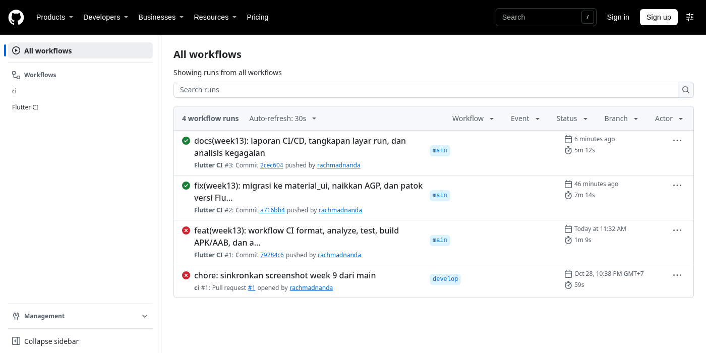
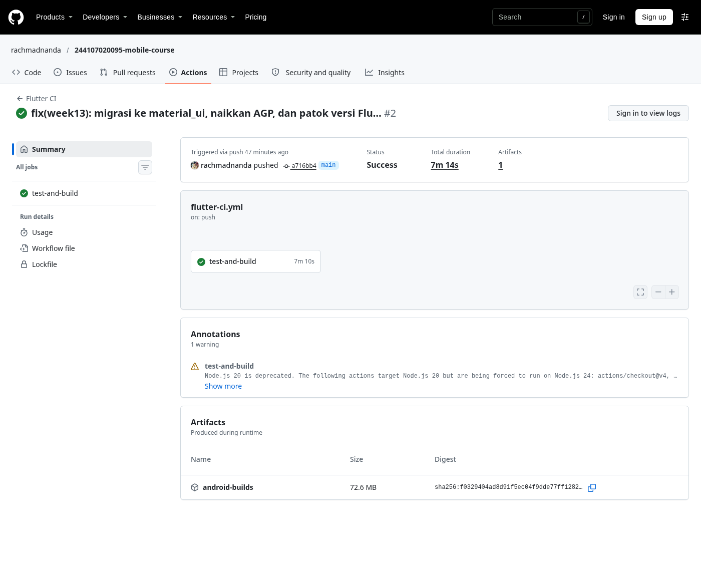
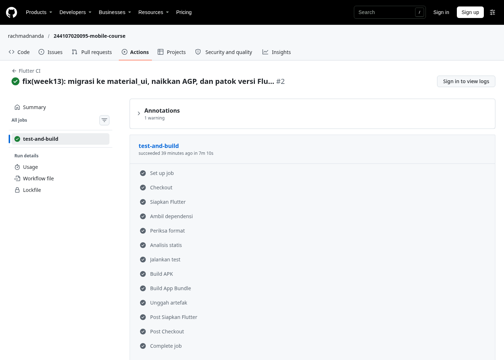
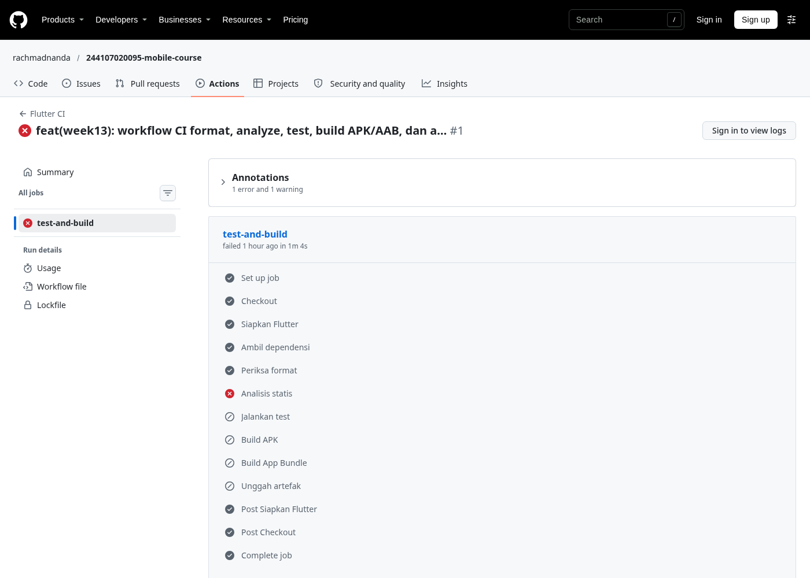
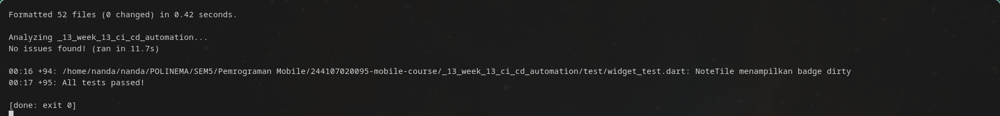
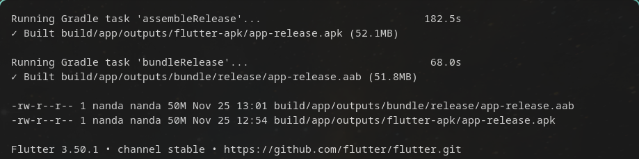

# Week 13 — CI/CD dan Otomatisasi

Melanjutkan aplikasi catatan **Week 12** (`../_12_week_12_testing_quality_assurance/`).
Minggu ini tidak menambah fitur. Yang dibangun adalah **pipeline yang
menjalankan pemeriksaan dan build secara otomatis** setiap ada perubahan, lalu
menyimpan APK/AAB sebagai artefak yang bisa ditinjau.

> **Status verifikasi (25 November 2026):**
> workflow `Flutter CI` **hijau** pada commit `a716bb4` dan `2cec604` —
> run [#2](https://github.com/rachmadnanda/244107020095-mobile-course/actions/runs/45553405020)
> (7m 14s) dan
> [#3](https://github.com/rachmadnanda/244107020095-mobile-course/actions/runs/45557977150)
> (5m 12s), artefak `android-builds` 72,6 MB.
> Tag `v1.0.1` menunjuk `a716bb4`.
> Bukti tangkapan layar ada di [`screenshots/`](screenshots/README.md),
> analisis lengkap di [`docs/ci-cd-report.md`](docs/ci-cd-report.md).

## Pemetaan 6 halaman modul

| # | Halaman modul | Yang dikerjakan di project ini | Bukti |
| --- | --- | --- | --- |
| 1 | CI dan CD | Pipeline: commit → runner → format/analyze/test → build → artefak | [`gh-01-runs.png`](screenshots/gh-01-runs.png) |
| 2 | Event dan permission | Trigger `push`, `pull_request`, `workflow_dispatch`; `permissions: contents: read`; `concurrency` | `.github/workflows/flutter-ci.yml` |
| 3 | Workflow + cek lokal | File workflow, lalu perintah yang sama dijalankan lokal sebelum push | [`01-cek-lokal.png`](screenshots/01-cek-lokal.png) |
| 4 | Langkah build | `flutter build apk --release`, `flutter build appbundle --release`, `upload-artifact` | [`gh-03-run-steps.png`](screenshots/gh-03-run-steps.png) |
| 5 | Versioning & rahasia | `1.0.1+2`, tag `v1.0.1`, daftar risiko keamanan | bagian di bawah |
| 6 | Jalankan workflow | Push ke `main`, tinjau tiap step, unduh artefak, catat commit | [`gh-02-run-summary.png`](screenshots/gh-02-run-summary.png) |

## Workflow

File: [`.github/workflows/flutter-ci.yml`](../.github/workflows/flutter-ci.yml)

```yaml
name: Flutter CI

on:
  push:
    branches: [main]
  pull_request:
    branches: [main]
  workflow_dispatch:

permissions:
  contents: read

concurrency:
  group: ${{ github.workflow }}-${{ github.ref }}
  cancel-in-progress: true

jobs:
  test-and-build:
    runs-on: ubuntu-latest
    defaults:
      run:
        working-directory: _13_week_13_ci_cd_automation
    steps:
      - Checkout              # actions/checkout@v4
      - Siapkan Flutter       # subosito/flutter-action@v2, flutter-version: 3.50.1
      - Ambil dependensi      # flutter pub get
      - Periksa format        # dart format --output=none --set-exit-if-changed .
      - Analisis statis       # flutter analyze --fatal-infos
      - Jalankan test         # flutter test --coverage
      - Build APK             # flutter build apk --release
      - Build App Bundle      # flutter build appbundle --release
      - Unggah artefak        # actions/upload-artifact@v4, name: android-builds
```

### Tiga penyesuaian dari contoh codelab

Codelab mengasumsikan aplikasi ada di root repository. Di repo ini aplikasi
berada di subfolder, dan ada satu masalah versi SDK yang harus diselesaikan.

| Perubahan | Alasan |
| --- | --- |
| `defaults.run.working-directory: _13_week_13_ci_cd_automation` | Semua `run:` harus dijalankan di folder aplikasi, bukan root repo |
| Path artefak diberi prefix folder | Step `uses:` **mengabaikan** `defaults.run.working-directory`, jadi path harus lengkap dari root |
| `flutter-version: 3.50.1` (dipatok) | `channel: stable` bergerak setiap rilis baru dan sudah pernah membuat run gagal (lihat bagian "Kegagalan pertama") |

## Kegagalan pertama, dan penyebabnya

Run #1 (`79284c6`) **gagal** dalam 1m 9s pada step **Analisis statis**, padahal
perintah yang sama bersih di laptop.

| | Lokal | CI |
| --- | --- | --- |
| Flutter | 3.47.2 | **3.50.1** (rilis 5 hari sebelumnya) |
| `flutter analyze --fatal-infos` | No issues found | **15 issues** |

Penyebabnya: Flutter 3.50.1 menandai `package:flutter/material.dart` sebagai
**deprecated** dengan pesan *"Use package:material_ui/material_ui.dart
instead"*. Lima belas file mengimpornya, semuanya menjadi `info`, dan
`--fatal-infos` mengubah `info` menjadi kegagalan.

Temuan ini justru contoh nyata nilai CI: **mesin lokal dan runner memakai versi
SDK berbeda**, dan perbedaan itu tidak terlihat sampai pipeline dijalankan.

### Perbaikan

1. **Migrasi ke `material_ui`** — tambah `material_ui: ^1.11.1` (paket resmi
   Flutter, butuh Flutter ≥ 3.47) dan ganti import di 15 file.
2. **Naikkan AGP** `9.1.0` → `9.1.1`. Flutter 3.50.1 menolak build dengan AGP
   9.1.0 (`lower than Flutter's minimum supported version`). Ini baru muncul
   setelah analisis lolos, jadi tanpa memperbaikinya build akan gagal juga.
3. **Patok `flutter-version: 3.50.1`** agar hasil CI dapat direproduksi dan
   tidak berubah diam-diam saat SDK naik.

Migrasi ini diuji dulu di salinan terpisah dengan Flutter 3.50.1 sebelum
diterapkan ke repo: analyze bersih, 95/95 test lulus, APK dan AAB terbangun.

## Hasil run

| | Run #1 | Run #2 | Run #3 |
| --- | --- | --- | --- |
| Commit | `79284c6` | `a716bb4` | `2cec604` |
| Isi commit | workflow pertama | migrasi + AGP + pin versi | dokumentasi |
| Hasil | ❌ failure | ✅ **success** | ✅ **success** |
| Durasi | 1m 9s | 7m 14s | 5m 12s |
| Gagal di | Analisis statis | — | — |
| Artefak | – | `android-builds` (72,6 MB) | `android-builds` (72,6 MB) |

Run #3 penting sebagai bukti tambahan: commit yang **hanya menyentuh
dokumentasi** tetap menjalankan seluruh pipeline dan tetap hijau, sehingga
artefak selalu berasal dari source yang sudah diverifikasi.

Run #2 — seluruh 10 step hijau:

```
Set up job → Checkout → Siapkan Flutter → Ambil dependensi → Periksa format
→ Analisis statis → Jalankan test → Build APK → Build App Bundle
→ Unggah artefak → (post steps) → Complete job
```

Artefak: `android-builds`, 72,6 MB, SHA-256
`f0329404ad8d91f5ec04f9dde77ff12829ae2e7deed9e7c8962dfddeb1bc4b15`,
retensi 7 hari.

### Bukti tangkapan layar

**Daftar run** — `Flutter CI #2` hijau, `#1` merah:



**Ringkasan run #2** — Success, 7m 14s, satu artefak 72,6 MB:



**Run #3 (commit dokumentasi)** — juga hijau, 5m 12s:


**Detail step run #2** — sepuluh langkah, semuanya hijau:



**Run #1 yang gagal** — berhenti di "Analisis statis", step build `skipped`:



### Verifikasi lokal dengan Flutter 3.50.1

Perintah yang sama dengan CI, dijalankan di mesin lokal memakai SDK yang
dipatok workflow:



## Verifikasi lokal

Dijalankan dengan **Flutter 3.50.1**, versi yang sama dengan CI:

```bash
dart format --output=none --set-exit-if-changed .
# Formatted 52 files (0 changed)

flutter analyze --fatal-infos
# No issues found! (ran in 11.7s)

flutter test
# 00:17 +95: All tests passed!

flutter build apk --release
# ✓ Built build/app/outputs/flutter-apk/app-release.apk (53.1MB)

flutter build appbundle --release
# ✓ Built build/app/outputs/bundle/release/app-release.aab
```

### Bukti tangkapan layar

**Cek lokal** — format, analyze, 95 test:


**Build lokal** — APK dan AAB dengan Flutter 3.50.1:



## Versi

| Item | Nilai |
| --- | --- |
| `pubspec.yaml` | `version: 1.0.1+2` |
| Sebelumnya (Week 12) | `1.0.0+1` |
| Tag | `v1.0.1` pada `a716bb4` |
| Alasan naik | Perubahan kompatibel (migrasi import + AGP), tanpa fitur baru → **patch**; build number naik 1 → 2 |

Semantic versioning: `major` untuk perubahan tidak kompatibel, `minor` untuk
fitur baru yang kompatibel, `patch` untuk perbaikan. Build number dinaikkan
setiap kali menghasilkan artefak baru untuk unggahan.

## Perbaikan Week 7 (bonus)

`.github/workflows/ci.yml` dari Week 8 ternyata **merah** sejak 28 Oktober: satu
run (`40718027624`) gagal di `flutter analyze` dengan
`info • The package name '_07_week_7_clean_architecture' isn't a
lower_case_with_underscores identifier`.

Perbaikannya kecil: ganti nama package menjadi `week_07_clean_architecture` di
`pubspec.yaml` dan 5 file test yang mengimpornya.

Hasil setelah perbaikan (lokal):

```text
Formatted 24 files (0 changed)
Analyzing _07_week_7_clean_architecture...
No issues found!
00:12 +23: All tests passed!
```

Workflow `ci.yml` lama sengaja **tidak diubah** agar tidak menyentuh konfigurasi
Week 8; ia akan hijau pada pull request berikutnya.

## Risiko keamanan yang masih terbuka

| Risiko | Dampak | Mitigasi yang belum dilakukan |
| --- | --- | --- |
| APK/AAB ditandatangani **debug key** | Tidak layak dipublikasikan; siapa pun bisa menandatangani ulang | Buat keystore rilis, simpan di GitHub Secrets, injeksi hanya pada workflow rilis |
| Keystore produksi belum ada | Belum bisa rilis bertanda tangan resmi | Ikuti panduan resmi Flutter untuk signing; jangan taruh keystore di workflow PR |
| Artefak kedaluwarsa 7 hari | Bukti hilang setelah sepekan | Unduh dan arsipkan artefak penting di luar GitHub |
| Action pihak ketiga dipin ke **tag**, bukan SHA | Tag bisa dipindahkan pemilik repo action | Pin ke commit SHA (`subosito/flutter-action@<sha>`) |
| `permissions: contents: read` | Sudah minimum, tetapi belum ada `GITHUB_TOKEN` scoping per job | Tambahkan bila nanti ada job rilis |
| Log publik | Log run bisa dibaca siapa pun | Jangan pernah mencetak secret; `--dart-define` juga **bukan** secret karena bisa diekstrak dari APK |
| Belum ada branch protection | Push langsung ke `main` tetap menjalankan CI, tetapi tidak memblokir merge merah | Aktifkan required status check `test-and-build` |

## Temuan yang belum terselesaikan

1. **Integration test tidak jalan di CI.** Runner `ubuntu-latest` tidak punya
   emulator. Yang dijalankan hanya 95 test unit/widget.
2. **Peringatan Node.js 20.** GitHub menandai `actions/checkout@v4` masih
   menargetkan Node.js 20 (dipaksa jalan di Node.js 24). Belum mengganggu,
   tetapi perlu pembaruan action saat tersedia.
3. **Gradle/AGP/Kotlin "soon to be dropped".** Build lokal memberi peringatan
   bahwa Gradle 9.3.1, AGP 9.1.1, dan Kotlin 2.4.10 akan segera tidak didukung;
   targetnya Gradle ≥ 9.5.0, AGP ≥ 9.3.1, Kotlin ≥ 2.4.20.
4. **Hanya satu varian build.** Belum ada `--split-per-abi`, flavor
   staging/production, atau build iOS.
5. **Cakupan tidak diunggah.** `flutter test --coverage` dijalankan, tetapi
   `lcov` tidak diunggah sebagai artefak atau dikirim ke layanan cakupan.
6. **`ci.yml` lama tetap ada.** Akan merah pada PR berikutnya bila ada
   perubahan yang memicunya dan tidak menyentuh Week 7 — sudah diperbaiki,
   tetapi belum diverifikasi lewat run nyata.

## Refleksi

**1. Masalah apa yang ditemukan otomatis sebelum perubahan di-merge?**

Pada run pertama, CI menangkap hal yang tidak terlihat di laptop: dengan
Flutter 3.50.1, `package:flutter/material.dart` sudah deprecated di 15 file dan
`--fatal-infos` menjadikannya kegagalan. Setelah itu diperbaiki, CI juga
menemukan bahwa AGP 9.1.0 di bawah minimum Flutter 3.50.1 sehingga build
release akan gagal. Dua masalah ini akan lolos ke `main` kalau hanya
mengandalkan `flutter analyze` di mesin lokal yang masih 3.47.2. Selain itu,
CI memastikan format, analisis, dan 95 test tetap dijalankan pada setiap push —
termasuk commit dokumentasi yang biasanya dianggap "aman".

**2. Informasi apa yang Anda butuhkan untuk menyelidiki build yang gagal?**

Yang paling membantu, berurutan: **nama step yang gagal** (langsung menunjuk
lapisan masalah — di sini "Analisis statis"), **commit SHA** yang memicu run,
**versi SDK** yang dipakai runner, dan **pesan galat lengkap**. Karena log
detail butuh login, saya mereproduksi kegagalan dengan mengunduh Flutter 3.50.1
secara lokal dan menjalankan perintah yang sama — cara itu memberi pesan
lengkap tanpa menebak. Tanpa versi SDK yang dipatok, kegagalan seperti ini sulit
direproduksi karena `stable` berubah setiap rilis.

**3. Bagian mana yang masih perlu persetujuan atau pemeriksaan manual sebelum
rilis?**

Semuanya yang berkaitan dengan identitas dan distribusi: **signing key**
(sekarang masih debug key), **versioning dan tag**, **isi changelog**, serta
**pengujian di perangkat fisik**. CI hanya membuktikan kode lolos format,
analisis, test, dan bisa dibangun — bukan bahwa aplikasi layak dipublikasikan.
Persetujuan manusia tetap diperlukan untuk memutuskan kapan menaikkan versi,
apa yang masuk rilis, dan apakah risiko keamanan di tabel atas sudah
ditutup. Untuk Play Store, unggahan juga tidak otomatis: masih manual dan
butuh akun serta keystore yang benar.

## Menjalankan

```bash
cd _13_week_13_ci_cd_automation
flutter pub get

# Sama persis dengan langkah CI
dart format --output=none --set-exit-if-changed .
flutter analyze --fatal-infos
flutter test --coverage
flutter build apk --release
flutter build appbundle --release
```

Untuk memicu pipeline: push ke `main`, buka pull request ke `main`, atau
jalankan manual lewat tab **Actions → Flutter CI → Run workflow**.

## Struktur

```text
.github/workflows/flutter-ci.yml     # pipeline utama (Week 13)
.github/workflows/ci.yml             # CI lama Week 8 (tidak diubah)
_13_week_13_ci_cd_automation/
├── lib/                             # aplikasi Week 12 (import material_ui)
├── test/                            # 95 test unit + widget
├── integration_test/                # 1 test (tidak dijalankan di CI)
├── docs/ci-cd-report.md             # analisis pipeline & risiko
└── screenshots/                     # bukti run GitHub Actions + cek lokal
```

## Dokumentasi

- [`docs/ci-cd-report.md`](docs/ci-cd-report.md) — alur pipeline, analisis
  kegagalan pertama, perbandingan versi SDK, risiko keamanan.
- [`screenshots/README.md`](screenshots/README.md) — inventaris bukti.
